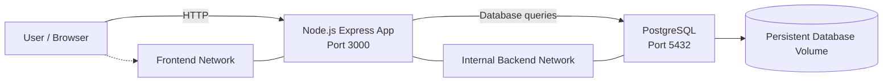
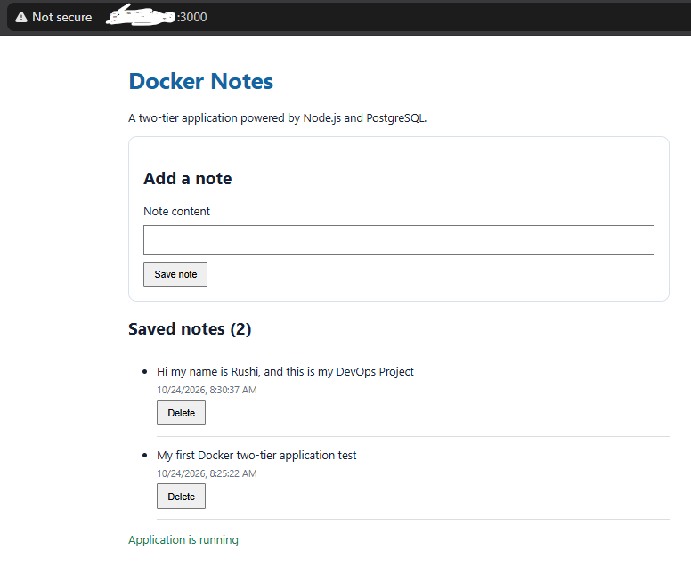
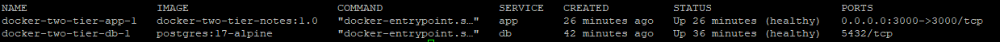
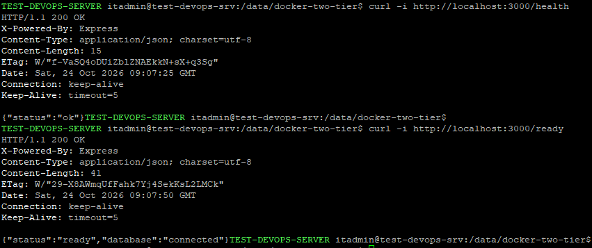
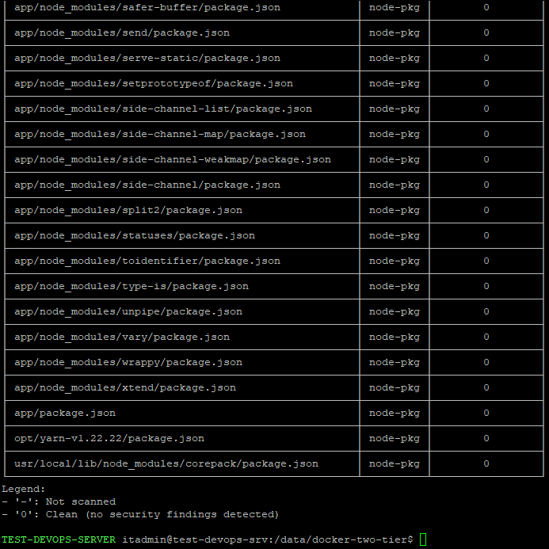

# Docker Two-Tier Notes Application

A containerized Notes application built with Node.js, Express, PostgreSQL, Docker, and Docker Compose. This project demonstrates practical DevOps skills in containerization, service networking, persistent storage, health monitoring, container hardening, and vulnerability scanning.

## Project Overview

The application allows users to create, view, and delete notes. The Node.js application communicates with PostgreSQL over a private Docker network, while PostgreSQL data is persisted in a named Docker volume.

### Key Features

- Node.js and Express web application
- PostgreSQL database with persistent storage
- Docker Compose multi-container orchestration
- Separate frontend and backend Docker networks
- Application health and database readiness endpoints
- Non-root application execution
- Read-only application container filesystem
- Reduced Linux capabilities and `no-new-privileges`
- Trivy container-image vulnerability scanning

## Architecture


## Network Design

- **Frontend network:** Connects the application to the frontend-facing Docker network.
- **Backend network:** An internal Docker network used for application-to-database communication.
- **Database security:** PostgreSQL does not publish port `5432` on the host.
- **Application access:** The application is published on host port `3000`.

## Technology Stack

| Technology | Purpose |
|---|---|
| Ubuntu Linux | Host operating system |
| Docker Engine | Container runtime |
| Docker Compose | Multi-container orchestration |
| Node.js 22 | Application runtime |
| Express | Web framework |
| PostgreSQL 17 | Relational database |
| Trivy | Container-image vulnerability scanning |
| Git and GitHub | Source control and project hosting |

## Repository Structure

```text
docker-two-tier-notes/
├── app/
│   ├── Dockerfile
│   ├── .dockerignore
│   ├── package.json
│   └── server.js
├── reports/
│   └── .gitkeep
├── screenshots/
│   ├── application.png
│   ├── containers-healthy.png
│   ├── health-checks.png
│   └── trivy-scan.png
├── .env.example
├── .gitignore
├── compose.yaml
└── README.md
```
## Prerequisites

Before starting, ensure you have the following installed:

- Linux host or virtual machine
- Docker Engine
- Docker Compose plugin
- Git
- Trivy (optional, for reproducing the security scan)

## Installation and Setup

### 1. Clone the Repository

**Using SSH:**

```bash
git clone git@github.com:Optimus-95/docker-two-tier-notes.git
cd docker-two-tier-notes
```

Alternatively, clone using HTTPS:

```bash
git clone https://github.com/Optimus-95/docker-two-tier-notes.git
cd docker-two-tier-notes
```

### 2. Configure Environment Variables

Create your local environment file from the example:

```bash
cp .env.example .env
nano .env
```

Configure the following values, using a strong, unique password for your database:

```dotenv
DB_NAME=notesdb
DB_USER=notesapp
DB_PASSWORD=replace_with_a_strong_random_password
```

Replace the example password with your own secure password.

**Security note:** Never commit your real `.env` file or publish passwords, tokens, or private keys.

### 3. Build and Start the Application

Build the image and start the application and database containers:

```bash
docker compose up -d --build
```

### 4. Check Container Status

```bash
docker compose ps
```

Wait until the application and database health checks report `healthy`.

### 5. Open the Application

Open the following address in your browser:

```text
http://YOUR_SERVER_IP:3000
```

Replace `YOUR_SERVER_IP` with your server's reachable IP address.

If accessing the server remotely, configure appropriate firewall rules for port `3000` and restrict access as appropriate for your environment.

## Health Checks and Validation

### Application Health

Run:

```bash
curl -i http://localhost:3000/health
```

Expected response:

```json
{
  "status": "ok"
}
```

### Database Readiness

Run:

```bash
curl -i http://localhost:3000/ready
```

Expected response:

```json
{
  "status": "ready",
  "database": "connected"
}
```

### View Application Logs

Display the latest application logs:

```bash
docker compose logs --tail=100 app
```

Follow application logs in real time:

```bash
docker compose logs -f app
```

Press `Ctrl+C` to stop following the logs.

### Verify Database Persistence

1. Open the application and create a note.
2. Restart the containers:

   ```bash
   docker compose restart
   ```

3. Refresh the application.
4. Verify that the note is still available.

The PostgreSQL named volume preserves database data across normal container restarts and container recreation, provided the volume is retained.

## Container Security

The project implements the following security controls:

| Security Control | Implementation |
|---|---|
| Non-root execution | Application runs as the `node` user |
| Read-only filesystem | Application container uses `read_only: true` |
| Reduced privileges | All Linux capabilities are dropped for the application container |
| Privilege escalation protection | `no-new-privileges` is enabled |
| Network isolation | Dedicated frontend and internal backend networks |
| Database exposure | PostgreSQL has no host port mapping |
| Persistent data | Named Docker volume for PostgreSQL |
| Secret configuration | Environment variables supplied through `.env` |
| Health monitoring | Docker health checks and `/health` and `/ready` endpoints |
| Image vulnerability scanning | Trivy vulnerability scanning |

These controls help reduce exposure but do not replace host patching, secret rotation, access control, or ongoing security reviews.

## Vulnerability Scanning with Trivy

Scan the application image for HIGH and CRITICAL vulnerabilities:

```bash
trivy image \
  --scanners vuln \
  --severity HIGH,CRITICAL \
  docker-two-tier-notes:1.0
```

**Latest project test:** The rebuilt image's latest Trivy scan reported zero vulnerabilities in the selected HIGH and CRITICAL severity categories.

This result applies to the specific image and scan configuration at that time. Re-scan images after rebuilding or updating dependencies.

## Screenshots

The project screenshots are stored in the `screenshots/` directory.

### Application Interface



### Docker Compose Container Status



### Health and Readiness Checks



### Trivy Vulnerability Scan



## Lessons Learned

Through this project, I gained hands-on experience with:

- Building and running a multi-container application using Docker Compose
- Configuring service discovery and container networks
- Persisting PostgreSQL data using named Docker volumes
- Implementing health checks and readiness validation
- Applying container hardening and least-privilege principles
- Scanning container images for known vulnerabilities with Trivy
- Managing and publishing source code using Git and GitHub

## Future Improvements

Potential enhancements for this project include:

- Integrating Jenkins CI/CD automation
- Automating image vulnerability scanning in the build pipeline
- Adding automated integration tests
- Publishing versioned images to a container registry
- Adding monitoring and deployment rollback automation

## Repository

**GitHub:** [Optimus-95/docker-two-tier-notes](https://github.com/Optimus-95/docker-two-tier-notes)

**Purpose:** A hands-on DevOps portfolio project demonstrating containerization, networking, persistent storage, health checks, security hardening, and vulnerability scanning.
