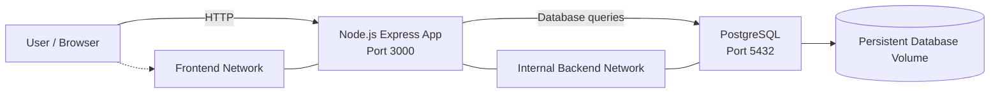

# Docker Two-Tier Notes Application

A containerized Notes application built with Node.js, Express, PostgreSQL, Docker, and Docker Compose. This project demonstrates practical DevOps skills in containerization, service networking, persistent storage, health monitoring, container hardening, and vulnerability scanning.

## Project Overview

The application allows users to create, view, and delete notes. The Node.js application communicates with PostgreSQL over a private Docker network, while PostgreSQL data is persisted in a named Docker volume.

### Key Features

- Node.js and Express web application
- PostgreSQL database with persistent storage
- Docker Compose multi-container orchestration
- Separate frontend and backend Docker networks
- Application health and database readiness endpoints
- Non-root application execution
- Read-only application container filesystem
- Reduced Linux capabilities and `no-new-privileges`
- Trivy container-image vulnerability scanning

## Architecture

Network Design
- Frontend network: connects the application to the frontend-facing Docker network.
- Backend network: an internal Docker network used for application-to-database communication.
- PostgreSQL does not publish port 5432 on the host.
- The application is published on host port 3000.
Technology Stack
Technology	Purpose
Ubuntu Linux	Host operating system
Docker Engine	Container runtime
Docker Compose	Multi-container orchestration
Node.js 22	Application runtime
Express	Web framework
PostgreSQL 17	Relational database
Trivy	Container-image vulnerability scanning
Git and GitHub	Source control and project hosting

Repository Structure
docker-two-tier-notes/
├── app/
│   ├── Dockerfile
│   ├── .dockerignore
│   ├── package.json
│   └── server.js
├── reports/
│   └── .gitkeep
├── screenshots/
│   └── .gitkeep
├── .env.example
├── .gitignore
├── compose.yaml
└── README.md

Prerequisites
- Linux host or virtual machine
- Docker Engine
- Docker Compose plugin
- Git
- Trivy (optional, for reproducing the security scan)
Installation and Setup
1. Clone the repository
Using SSH:
git clone git@github.com:Optimus-95/docker-two-tier-notes.git
cd docker-two-tier-notes

Alternatively, clone the repository using its HTTPS URL.
2. Configure environment variables
cp .env.example .env
nano .env

Set a strong, unique database password in .env.
DB_NAME=notesdb
DB_USER=notesapp
DB_PASSWORD=replace_with_a_strong_random_password

Never commit the real .env file or publish passwords, tokens, or private keys.
3. Build and start the application
docker compose up -d --build

4. Check container status
docker compose ps

Wait for the application and database health checks to report healthy.
5. Open the application
Open the following address in your browser:
http://YOUR_SERVER_IP:3000

Replace YOUR_SERVER_IP with your server's reachable IP address. If accessing the server remotely, configure appropriate firewall rules for port 3000.
Health Checks and Validation
Application health
curl -i http://localhost:3000/health

Expected response:
{"status":"ok"}

Database readiness
curl -i http://localhost:3000/ready

Expected response:
{"status":"ready","database":"connected"}

View application logs
docker compose logs --tail=100
docker compose logs -f app

Verify database persistence
1. Create a note in the application.
2. Restart the containers:
   docker compose restart
3. Refresh the application and verify that the note remains.
The PostgreSQL named volume preserves database data across normal container restarts and recreation.
Container Security
Security control	Implementation
Non-root execution	Application runs as the node user
Read-only filesystem	Application container uses read_only: true
Reduced privileges	All Linux capabilities dropped for the application container
Privilege escalation	no-new-privileges enabled
Network isolation	Dedicated frontend and internal backend networks
Database exposure	No host port mapping for PostgreSQL
Persistent data	Named Docker volume for PostgreSQL
Secret configuration	Environment variables supplied through .env
Health monitoring	Docker health checks plus /health and /ready endpoints
Image vulnerability scanning	Trivy

These controls reduce exposure but do not replace host patching, secret rotation, access control, or ongoing security reviews.
Vulnerability Scanning with Trivy
Scan the application image for HIGH and CRITICAL vulnerabilities:
trivy image \
  --scanners vuln \
  --severity HIGH,CRITICAL \
  docker-two-tier-notes:1.0

Latest project test: The rebuilt image's latest Trivy scan reported zero vulnerabilities in the selected HIGH and CRITICAL severity categories.

This result describes that image and scan configuration at that time. Re-scan images after rebuilding or updating dependencies.
Screenshots
Project screenshots will be stored in the screenshots/ directory.
Application Interface
Docker Compose Container Status
Health and Readiness Checks
Trivy Vulnerability Scan
Lessons Learned
- Building and running a multi-container application with Docker Compose
- Configuring service discovery and container networks
- Persisting PostgreSQL data using named Docker volumes
- Implementing health checks and readiness validation
- Applying container hardening and least-privilege principles
- Scanning images for known vulnerabilities with Trivy
- Managing and publishing source code with Git and GitHub
Future Improvements
- Integrate Jenkins CI/CD automation
- Automate image vulnerability scanning in the build pipeline
- Add automated integration tests
- Publish versioned images to a container registry
- Add monitoring and deployment rollback automation
Repository
GitHub: Optimus-95/docker-two-tier-notes

Purpose: Hands-on DevOps portfolio project.
